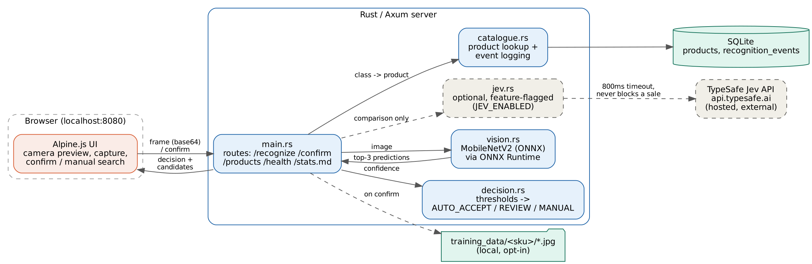

# Produce recognition prototype

A laptop webcam looks at a piece of produce, a local model guesses what it
is, and the cashier confirms or corrects it in a browser POS screen. Runs
fully offline. An optional hosted decision model (Jev) can be switched on
to compare against the built-in rules.

Status: M1 to M5 built. Benchmarked on still images of five produce
items, plus a simulated poor-camera test; live-webcam accuracy has not been
measured yet (see "Results" and
"Known limitations").

## How it works



1. The browser grabs a frame from the webcam and sends it to `/recognize`.
2. `vision.rs` runs MobileNetV2 (ONNX, from the ONNX Model Zoo) locally and returns the top 3
   guesses with confidence.
3. `catalogue.rs` maps the guesses to products in the local SQLite
   catalogue. Guesses that aren't products we sell are dropped.
4. `decision.rs` routes on the top guess's confidence:
   - **AUTO_ACCEPT** (>= 0.70 by default): shown with its price, one click
     to override
   - **REVIEW** (>= 0.30): top candidates shown as buttons
   - **MANUAL** (below that, or the top guess isn't one of our products):
     search box
5. Whatever the cashier picks goes to `/confirm`, which is logged against
   the original recognition event along with latency.
6. If `JEV_ENABLED=true`, the same candidates are also sent to Jev
   (api.typesafe.ai) and its answer is logged next to the rule-based
   decision for comparison. Jev never changes what the cashier sees, and a
   slow or failing Jev can't hold up a sale (800 ms timeout, errors are
   logged and ignored).

Thresholds can be changed without touching code:
`POS_AUTO_ACCEPT_THRESHOLD` and `POS_REVIEW_THRESHOLD`.

## Setup (Windows)

1. Install Rust from https://rustup.rs. Accept the Visual Studio C++ Build
   Tools install if it asks (choose "Desktop development with C++").
2. Download ONNX Runtime **1.20.1** (this exact version) for Windows x64:
   https://github.com/microsoft/onnxruntime/releases/download/v1.20.1/onnxruntime-win-x64-1.20.1.zip
   Unzip it and copy `lib\onnxruntime.dll` into this project's `lib\` folder.
3. In PowerShell, from the project folder:

```powershell
$env:ORT_DYLIB_PATH = ".\lib\onnxruntime.dll"
cargo run
```

First build takes a couple of minutes. Wait for `listening on
http://127.0.0.1:8080`, then open http://localhost:8080 in Chrome or Edge,
click **Enable camera**, hold an item up, click **Capture & Recognize**.

To also try Jev (needs an API key from console.typesafe.ai):

```powershell
$env:JEV_ENABLED = "true"
$env:TYPESAFE_API_KEY = "your key"
```

Keep the key out of chat, commits, and screenshots.

Linux: same thing with `ORT_DYLIB_PATH=./lib/libonnxruntime.so` (the Linux
library is included in `lib/`).

Tests: `cargo test` (covers the decision logic).

## Catalogue

10 products, all mapped to real ImageNet classes the model already knows:
Banana, Orange, Lemon, Broccoli, Cauliflower, Zucchini, Cucumber, Bell
Pepper, Mushroom, Strawberry. Prices are placeholders.

## Saving photos for retraining

The "Save photo when confirmed" checkbox (on by default) writes each
confirmed frame to `training_data/<sku>/`. Nothing is uploaded anywhere.
The label is whatever the tester confirmed, not what the model guessed, so
corrections are exactly the examples a fine-tuning run needs. This is how
the dataset for a future fine-tune gets built while testing.

## Results

Generated from the app's own event log (`/stats.md`), not estimated.

**What was tested:** one still image each of five catalogue items (banana,
broccoli, cucumber, lemon, orange), sent through the real `/recognize` and
`/confirm` endpoints. The lemon image has yellow cups in frame and the
cucumber image shows several cucumbers, so they're not all single-item
close-ups. Live-webcam accuracy was **not** measured, and one image per item
is too few to quote an accuracy rate. These results show the pipeline works
end to end with a model that recognises produce.

| Item | Top guess | Confidence | Decision |
|---|---|---|---|
| Banana | Banana | 99.9% | AUTO_ACCEPT |
| Broccoli | Broccoli | 99.8% | AUTO_ACCEPT |
| Lemon | Lemon | 81.2% | AUTO_ACCEPT |
| Cucumber | Cucumber | 64.5% (zucchini 35.4%) | REVIEW |
| Orange | Orange | 57.6% (lemon 41.9%) | REVIEW |

5/5 top-1 correct, 5 of the 10 catalogue items covered. The two REVIEW cases
are look-alike pairs (cucumber/zucchini, orange/lemon) where the model split
its confidence, which is the intended behaviour for a close call.

Raw `/stats.md` output from that run:

```
Latency (server-side /recognize): p50 51 ms, p95 77 ms, max 77 ms (5 runs, Linux CPU)
Decision routing: AUTO_ACCEPT 3, REVIEW 2, MANUAL 0
Top-1 correct: Banana 1/1, Orange 1/1, Lemon 1/1, Broccoli 1/1, Cucumber 1/1 (overall 5/5)
Jev: not enabled for this run
```

**Model change, and why.** The first version of this prototype shipped a
MobileNetV3-Small model file. Tests with it were poor: a clean broccoli photo
came back as "spotlight" and "lampshade", and a real banana on a webcam only
reached 38%. The preprocessing code was checked against an independent Python
run and gave identical numbers, so the model file was the cause. It was
replaced with the official ONNX Model Zoo MobileNetV2 (about 72% ImageNet
top-1), which gets the same photos right with high confidence. No application
code changed except the model path.

**Not yet re-measured with the new model:** the earlier webcam tests (banana,
mushroom, bell pepper, lime) were done with the old model file and have not
been repeated. Treat them as superseded. Per-item webcam accuracy on all 10
products is the main open item.

## Poor-camera test (simulated)

To see how the model copes with a weak camera, the same five photos were
degraded in code (resolution cut, blur, sensor noise, JPEG compression,
dimmer light, slight warm cast) and sent through the app. **This is a
simulation, not a live webcam capture**, and the settings are my own
choice, so treat the numbers as indicative. One image per item.

| Level | Settings |
|---|---|
| Mild (cheap webcam) | 320 px wide, blur 2.0, noise 8, JPEG q40, brightness x0.88 |
| Heavy (very poor, dim) | 160 px wide, blur 3.5, noise 14, JPEG q25, brightness x0.70 |

| Item | Mild result | Heavy result |
|---|---|---|
| Banana | AUTO_ACCEPT, Banana, correct | AUTO_ACCEPT, Banana 83.6%, correct |
| Broccoli | AUTO_ACCEPT, Broccoli, correct | AUTO_ACCEPT, Broccoli 78.9%, correct |
| Lemon | REVIEW, Lemon 44.8% first, correct | MANUAL (top guess "pill bottle", not a product), fell back safely |
| Cucumber | **AUTO_ACCEPT, Zucchini 87.3%, wrong** | **AUTO_ACCEPT, Zucchini 92.6%, wrong** |
| Orange | REVIEW, Lemon 65.5% first, Orange 30.9% second | REVIEW, only Lemon 41.6% offered, orange missing |

First guess correct: 3 of 5 (mild), 2 of 5 (heavy). In the recorded mild run
the cashier corrected the wrong cucumber auto-accept ("Not right?", search,
pick) and the correction was logged.

What this shows:
- Look-alike pairs (cucumber/zucchini, orange/lemon) get confused when the
  image is blurry, and the model can be **confidently** wrong, so a
  confidence threshold alone does not stop a wrong auto-accept.
- When confidence is low or the guess isn't a product, the app falls back to
  manual search, which is the intended safe behaviour (heavy lemon).
- In the heavy orange case the correct item wasn't offered at all, so the
  cashier has to use "None of these" and search.

Not implemented yet, but suggested: always send look-alike pairs to REVIEW,
show the runner-up even on auto-accept, and fine-tune on real camera frames.

## Known limitations

- **Only five still images have been benchmarked.** No live-webcam run with
  the current model, and only 5 of the 10 catalogue items (banana, broccoli,
  cucumber, lemon, orange) have been tested with it. Webcam frames are
  blurrier and less controlled than photos, so real accuracy is likely
  lower.
- **The model is not trained on produce under real conditions.** It's the
  stock ImageNet classifier, so expect lower confidence on a webcam, and
  similar-looking items (orange vs lemon, broccoli vs cauliflower, zucchini
  vs cucumber) can be confused. The REVIEW tier exists for exactly this.
- **ImageNet has no class for several local items.** There is no "lime"
  class, so a lime (limau nipis) can't be recognised and is a manual
  search. Same for anything not among the model's 1000 classes (blueberries,
  carrots, potatoes, onions).
- **The accuracy table counts only cashier-confirmed events.** Auto-accepted
  items are logged as events but are not in the table unless the cashier
  overrides them, so a wrong auto-accept would not show up as an error.
- **A confident wrong auto-accept is possible.** In the simulated poor-camera
  test a blurry cucumber was auto-accepted as zucchini at 87%. See
  "Poor-camera test (simulated)".
- **Search is English-only.** Typing "limau" or "pisang" finds nothing.
- **Frame quality matters a lot.** Everything is shrunk to 224x224 before
  recognition, so an item that doesn't fill most of the frame ends up as a
  few pixels. Plain background, good light, item close up.
- **Jev's success path hasn't been verified end to end yet.** The failure
  case (unreachable, bad key) is tested and cannot block a sale. See
  Results for whether a live call has been confirmed.
- **Windows needs the matching ONNX Runtime DLL added by hand** (step 2
  above); only the Linux library is bundled.
- No payment, scales, label printing, or multi-user handling. Out of scope
  for this prototype.

## Next steps

Run the 10 items through a live webcam and record the results. Then collect labelled photos with the checkbox above (aim for 20 to 30 per item,
varying angle and light), then fine-tune MobileNetV2 on them and swap
the new `.onnx` into `models/`. No code change needed. Add Malay aliases to
catalogue search, and add products ImageNet can't recognise as manual-only
items (e.g. limau nipis).

## Layout

```
src/main.rs        server, routes, wiring
src/vision.rs      ONNX model loading + inference
src/decision.rs    confidence -> AUTO_ACCEPT / REVIEW / MANUAL (unit tested)
src/catalogue.rs   SQLite products, event log, stats
src/jev.rs         optional Jev client
static/index.html  browser UI (Alpine.js is bundled as static/alpine.min.js, so the page works offline)
models/            ONNX model + ImageNet class names
lib/               ONNX Runtime shared library
docs/              architecture diagram
```
